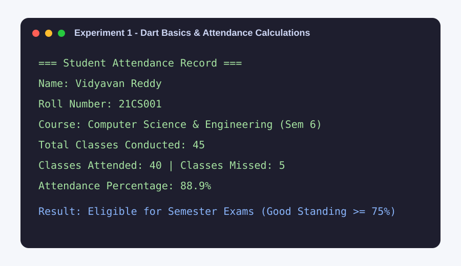
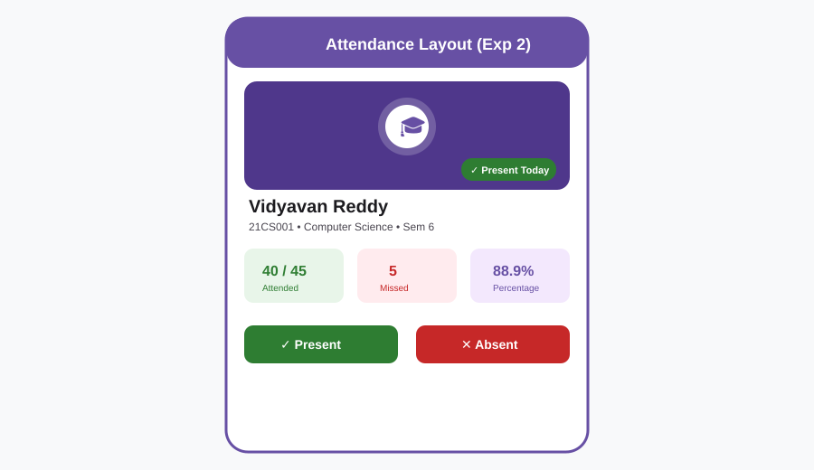
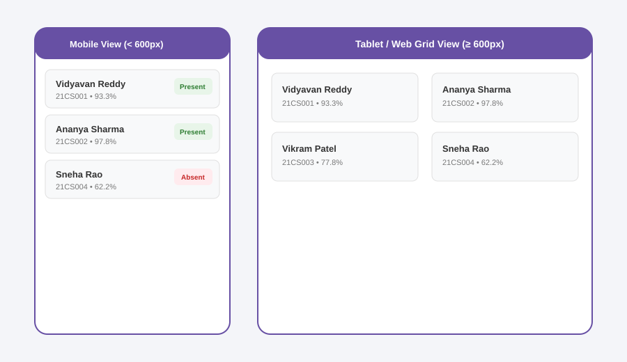
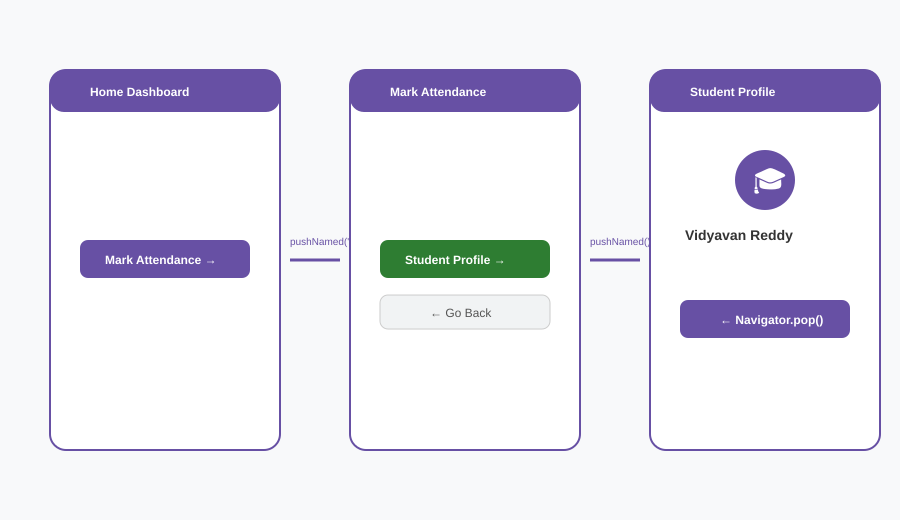
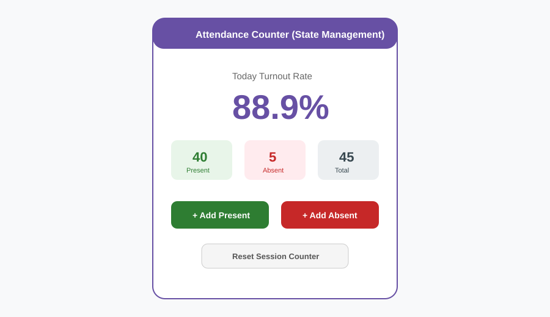
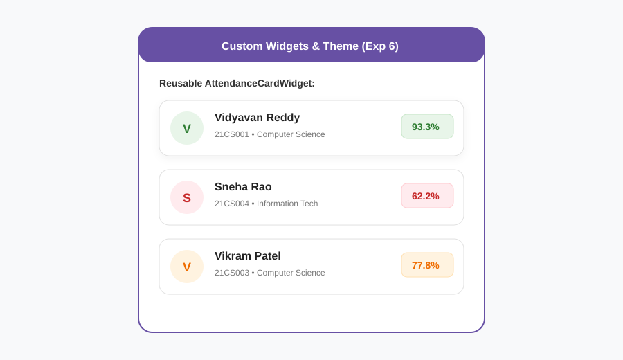
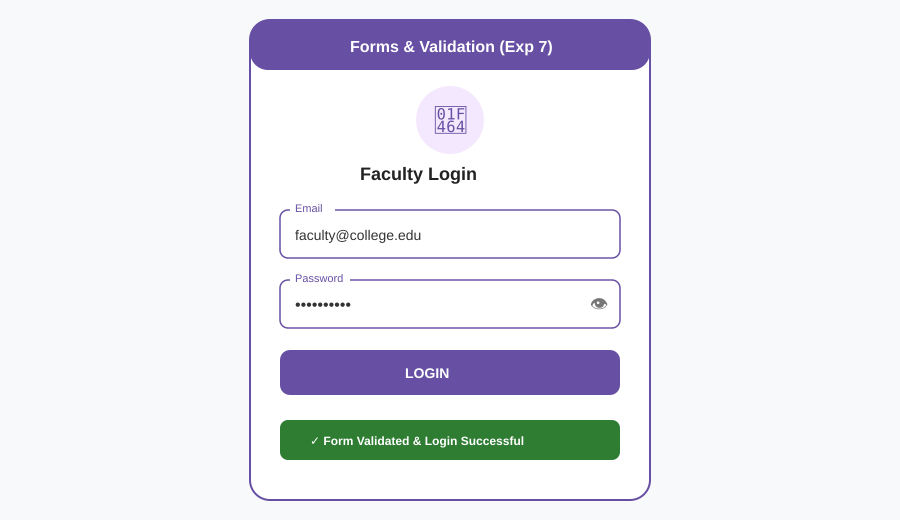
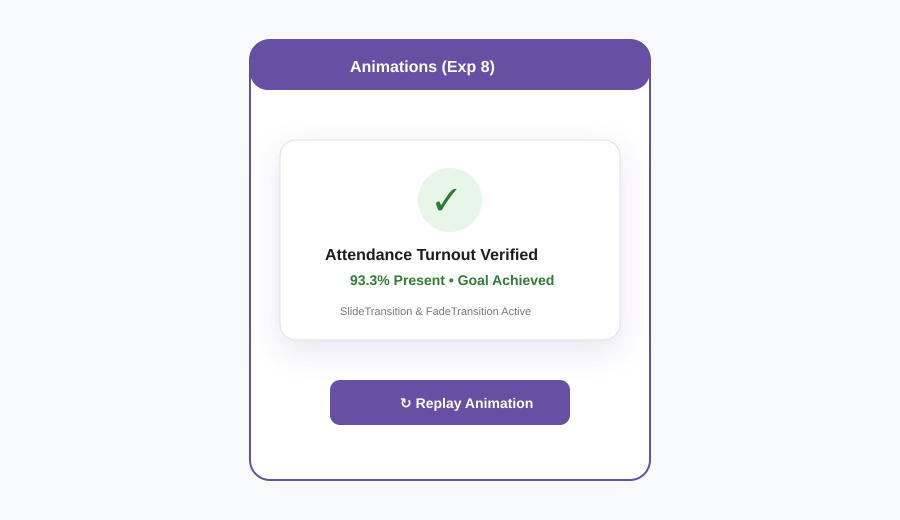
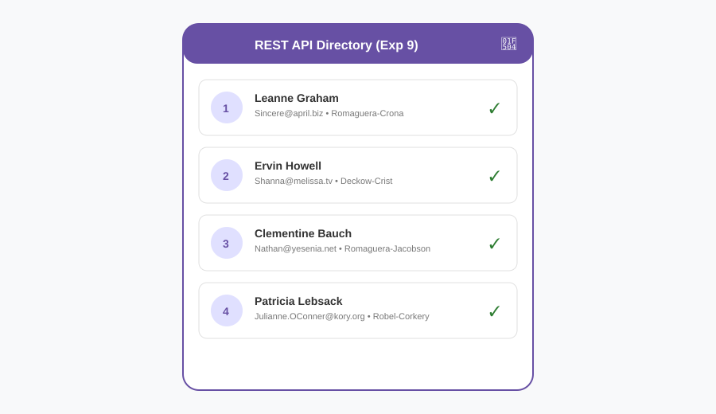
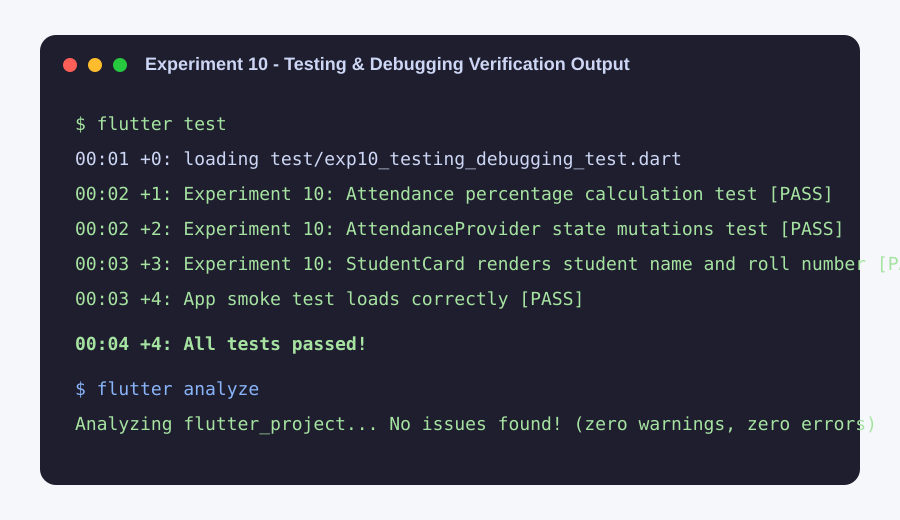

# Student Attendance App (Flutter)

## Abstract

The Student Attendance App is a cross-platform mobile and web application developed using **Flutter** and **Dart** to provide a modern, efficient, and user-friendly solution for tracking and managing academic student attendance. The application enables faculty, teachers, and administrators to take attendance in real time, monitor attendance percentages, identify students with shortages, record historical sessions, and maintain student directories in a centralized environment.

The app uses Flutter's reactive UI framework to deliver an adaptive and responsive experience across mobile, tablet, and desktop/web devices from a single codebase. Built-in state management using **Provider** and **setState()** ensures instantaneous metrics updates, while form validation safeguards data integrity during login and student enrollment.

---

## Experiments 1-10

### Experiment 1 - Dart Language Basics
Demonstrates Dart language fundamentals including variables, primitive data types, arithmetic operations, string interpolation, and conditional statements calculating student attendance percentage and exam eligibility criteria (75% threshold).

**Output:**



**Run the example:** `flutter run -t experiments/01_dart_basics.dart`

---

### Experiment 2 - Flutter Widgets and Layouts
Uses fundamental Flutter widgets with **Row**, **Column**, and **Stack** to construct a student attendance card with stacked avatar status indicators, aligned metrics, and interactive action buttons.

**Output:**



**Run the example:** `flutter run -t experiments/02_widgets_layouts.dart`

---

### Experiment 3 - Responsive UI
Uses **MediaQuery** and screen width breakpoints (`< 600px` for mobile `ListView.builder` vs `≥ 600px` for tablet/desktop `GridView.builder`) to adapt the student attendance interface dynamically across devices.

**Output:**



**Run the example:** `flutter run -t experiments/03_responsive_ui.dart`

---

### Experiment 4 - Navigation and Named Routes
Uses **Navigator.pushNamed()**, named route tables, and **Navigator.pop()** to establish a clean navigation flow between Dashboard, Mark Attendance, and Student Profile screens.

**Output:**



**Run the example:** `flutter run -t experiments/04_navigation_named_routes.dart`

---

### Experiment 5 - Stateful & Stateless Widgets + State Management
Demonstrates **StatelessWidget**, **StatefulWidget**, **setState()**, and **Provider** (`ChangeNotifier`, `ChangeNotifierProvider`, `notifyListeners()`) to manage live attendance counters and global session states.

**Output:**



**Run the example:** `flutter run -t experiments/05_setstate_counter.dart` (or `experiments/05_state_management.dart`)

---

### Experiment 6 - Custom Widgets and Themes
Creates reusable custom widgets (`AttendanceCardWidget`, `StatBadge`, `AttendanceStatusBadge`) and applies a cohesive Material 3 theme using **ThemeData**, custom color schemes, card styles, and button styling.

**Output:**



**Run the example:** `flutter run -t experiments/06_custom_widgets_themes.dart`

---

### Experiment 7 - Forms, Validation and Error Handling
Designs faculty login and student registration forms with input validation, field-level error messages, and submission handling using **Form**, **GlobalKey<FormState>**, **TextFormField**, and **SnackBar**.

**Output:**



**Run the example:** `flutter run -t experiments/07_forms_validation.dart`

---

### Experiment 8 - Animations
Uses Flutter's animation framework with **AnimationController**, **FadeTransition**, and **SlideTransition** to smoothly animate verified attendance percentages and summary milestones.

**Output:**



**Run the example:** `flutter run -t experiments/08_animations.dart`

---

### Experiment 9 - REST API Integration
Fetches online student records from a REST API using HTTP GET requests (`http` package). It parses JSON into Dart objects and displays the records with **FutureBuilder**, loading indicators, and retry error handling.

**Output:**



**Run the example:** `flutter run -t experiments/09_rest_api.dart`

---

### Experiment 10 - Testing and Debugging in Flutter
Automated unit and widget tests for student attendance percentage calculation, state mutations, and UI rendering. Demonstrates Flutter debugging tools including `debugPrint`, assertions, and Flutter DevTools.

**Output:**



**Run tests:** `flutter test`

---

## Experiment Files Directory

```text
experiments/
├── 01_dart_basics.dart
├── 02_widgets_layouts.dart
├── 03_responsive_ui.dart
├── 04_navigation_named_routes.dart
├── 05_setstate_counter.dart
├── 05_state_management.dart
├── 06_custom_widgets_themes.dart
├── 07_forms_validation.dart
├── 08_animations.dart
├── 09_rest_api.dart
├── 10_testing_debugging.dart
└── attendance_provider.dart
```

---

## Automated CI Verification

Continuous integration is automated via GitHub Actions in [`.github/workflows/flutter-verification.yml`](.github/workflows/flutter-verification.yml) to run code analysis and automated tests on every push to `main`:

```bash
flutter analyze
flutter test
```

---

## Run the Combined Student Attendance App (Flutter Web & Mobile)

The default app entry point (`lib/main.dart`) is a comprehensive faculty dashboard with student directory, live attendance marker, history logs, and profile inspection.

### Prerequisites:
- Flutter SDK (stable channel)
- Google Chrome (for web) or Android Device / Emulator

### Run locally:
```bash
# 1. Fetch dependencies
flutter pub get

# 2. Run in Chrome (Web)
flutter run -d chrome

# 3. Or run on an Android Device / Emulator
flutter run
```

### Build for production web hosting:
```bash
flutter build web --release
```
The deployable web output will be generated in `build/web/`.

---

## Author & Repository
- **Student / Author**: Vidyavan Reddy
- **GitHub Repository**: [https://github.com/vidyavanreddy/flutter_project.git](https://github.com/vidyavanreddy/flutter_project.git)
